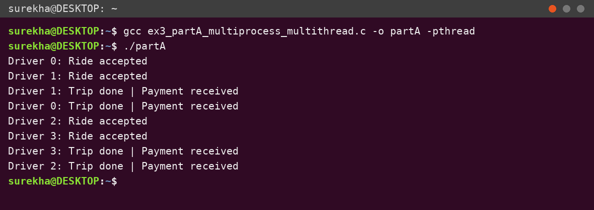
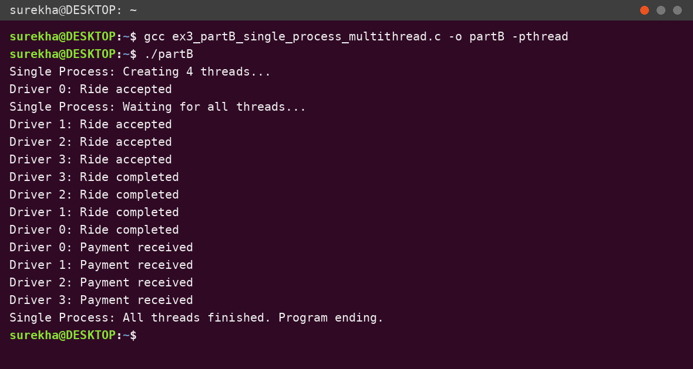

# EX NO 3 – Multithreading and pthread in C

## Aim
To implement and study Multithreading and pthread in C.

## Domain / Use Case
Uber-like ride booking system – each driver is handled by a separate thread.

## Files
| File | Description |
|------|-------------|
| `ex3_partA_multiprocess_multithread.c` | Part A – Multi Process Multi Threading (MPMT) |
| `ex3_partB_single_process_multithread.c` | Part B – Single Process Multi Threading (SPMT) |
| `ex3_partA_output.png` | Terminal output of Part A |
| `ex3_partB_output.png` | Terminal output of Part B |

## Part A – Multiprocess Multithreading
The parent calls `fork()` twice to create two child processes.
- Child 1 creates 2 threads for drivers 0 and 1.
- Child 2 creates 2 threads for drivers 2 and 3.
- Each thread runs `driver()`: prints *Ride accepted*, sleeps 1 second, then prints *Trip done | Payment received*.
- Each child uses `pthread_join()` to wait for its threads; the parent uses `wait()` twice to wait for both children.

### Compile and run
```bash
gcc ex3_partA_multiprocess_multithread.c -o partA -pthread
./partA
```

### Output


## Part B – Single Process Multithreading
One process creates 4 driver threads with `pthread_create()`. Each thread prints *Ride accepted*, sleeps 1 s, prints *Ride completed*, sleeps 1 s, then prints *Payment received*. `main()` waits for all threads with `pthread_join()` and then prints the final message.

### Compile and run
```bash
gcc ex3_partB_single_process_multithread.c -o partB -pthread
./partB
```

### Output


> Note: thread scheduling is non-deterministic, so the order of lines may differ between runs.

## Definitions
- **Thread** – smallest unit of execution in a process; has its own program counter but shares memory and resources with other threads of the same process.
- **Process** – a program in execution with its own address space, memory and resources.
- **MPMT (Multi Process Multi Threading)** – multiple processes, each containing multiple threads.
- **SPST (Single Process Single Threading)** – one process with one thread.
- **MPST (Multi Process Single Threading)** – multiple processes, each with one thread.
- **SPMT (Single Process Multi Threading)** – one process containing multiple threads sharing the same memory.

## Result
Successfully implemented and studied Multithreading and pthread in C.
